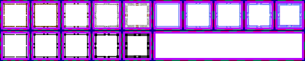

# sprite/world/centre/wall

These images are the walls round a region's centre on the world map, in five sizes that grow as the region's walls are built up. A race names two sheets in its [`WORLD`](../../../01-init/07-race/06-sprite/00-sprite.md#world) block: `WALL` for the centre of a faction's capital, tinted with `WALL_COLOR`, and `WALL_VILLAGE` for the centre of any other region, tinted with `WALL_VILLAGE_COLOR`. Both use this folder and the same layout.

## At a glance

| | |
|---|---|
| **Location** | `assets/sprite/world/centre/wall/` |
| **Files** | `Human.png` (Human `WALL`), `Human_Village.png` (Human `WALL_VILLAGE`), `Normal.png` (`WALL` for every other race) and `Village.png` (`WALL_VILLAGE` for every other race) |
| **Name** | The file name without `.png` |
| **Adding new files** | Yes. A race's `WORLD` block must name it with `WALL` or `WALL_VILLAGE`. |
| **Size** | Exactly 600 pixels wide and at least 120 high. Anything else stops the game with an error. |

## The sheet

The left half, 300 pixels wide, holds the sprites in colour, and the right half holds a matching normal map. Each half has 2 rows of 5 blocks, each block 60 pixels square. A block has a 6-pixel margin round 6 rows of 6 cells, each cell 8 pixels square, and the cells inside it touch. So a block's left edge is at 60 for each column and its top edge at 60 for each row, and a cell's edges are 6 plus 8 for each cell further into its block.

Each column of blocks is one size of wall, from the lowest in column 0 to the highest in column 4. The top row of blocks holds the walls, and the bottom row holds their shadows: the block under a wall gives the shape of that wall's shadow, cell for cell. In vanilla, the normal-map half of the shadow row is empty.

Move over a sprite on the sheet to see what it's for. This is the vanilla `Human.png`:

## The cells of a block

Only 20 of the 36 cells in a block are read. Counting cells from 0, left to right and then row by row:

| Cells | Used for |
|---|---|
| 0, 5, 30 and 35 | The corners: top-left, top-right, bottom-left and bottom-right |
| 2 and 3, 12 and 18, 17 and 23, 32 and 33 | The gates in the middle of the top, left, right and bottom sides, two cells each |
| 1, 4, 6, 11, 24, 29, 31 and 34 | The lengths of wall. Each is repeated from the corner beside it towards the gate: cell 1 rightwards along the top from the top-left corner, cell 4 leftwards from the top-right corner, and so on round the ring. |
| 7 to 10, 13 to 16, 19 to 22 and 25 to 28 | Not read |

The ring grows wider as the region's population rises, and the lengths of wall are repeated to fill it. The corners and gates are always drawn once.

## Which size is drawn

The size comes from the region's `WORLD_VISUAL_WALL` boost, which vanilla's walls building adds to at each level (see [`BOOST`](../../../01-init/15-world/01-building.md#boost)). The game holds the value between 0 and 1 and stores it in fifteenths, rounded down. No wall is drawn unless the stored value is above 0. Above that, the column is 5 times the stored value less 1, rounded and kept between 0 and 4. Vanilla's six wall levels, at full effect, give columns 0, 0, 1, 2, 3 and 4.

The player's capital works differently: its value is the number of fortification tiles in the settlement, divided by four times the settlement's width in tiles, up to 1.

The sheets are those of the race with the most people in the region. The shadow is drawn sharp-edged, taller for `WALL` than for `WALL_VILLAGE`.

## Related

- [sprite/world/centre](00-centre.md)
- [init/race: WORLD](../../../01-init/07-race/06-sprite/00-sprite.md#world)
- [init/world/building](../../../01-init/15-world/01-building.md)
