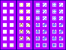

# sprite/world/entity/Army

`Army.png` holds the small figures that stand for an army on the world map. An army is drawn as a group of up to 16 of them, coloured with its faction's banner.

## At a glance

| | |
|---|---|
| **Location** | `assets/sprite/world/entity/` |
| **File** | `Army.png` |
| **Adding new files** | No. The game only asks for this name. |
| **Size** | Exactly 136 pixels wide and at least 104 high. Anything else stops the game with an error. The cells end at 98, so the last 6 rows of pixels are never read. |

## The sheet

The left half, 68 pixels wide, holds the sprites in colour, and the right half holds a matching normal map. Each half holds two blocks side by side, each 34 pixels wide, with 7 rows of 2 cells. Each cell is 8 pixels square, with 6 pixels around and between them. So in the left block a cell's left edge is at 6 or 20, in the right block at 40 or 54, and its top edge is at 6 plus 14 for each row.

In each row, the left cell faces north and the right cell north-east. The game turns each one a quarter, a half and three quarters clockwise for the other directions.

Move over a sprite on the sheet to see what it's for. This is the vanilla `Army.png`:

## Which sprite is drawn

Each figure is drawn in two layers from the same row and cell of the two blocks. The right block is drawn first, as painted, and its shape also gives the figure's shadow. The left block is drawn over it, tinted with the background colour of the faction's banner, or dark grey for an army with no faction. Paint the parts that should take the faction's colour in the left block, and the rest in the right.

| Row | Used for |
|---|---|
| 0 to 2 | On land. A moving army steps through the three rows, and one standing still uses row 0. |
| 3 to 5 | On water, in the same way. |
| 6 | A fortified army on land. |

The number of figures grows with the number of soldiers, up to 16 for an army with half the largest number of soldiers an army can hold or more. That largest number is [`MEN_PER_DIVISION`](../../../01-init/03-config/01-Battle.md#men_per_division) times [`DIVISIONS_PER_ARMY`](../../../01-init/03-config/01-Battle.md#divisions_per_army) in `init/config/Battle.txt`. The figures stand in rows of up to 4.

The dashed box drawn round an army, and the sparks of an army raiding, don't come from this sheet.

## Related

- [sprite/world/entity](00-entity.md)
- [init/config/Battle.txt](../../../01-init/03-config/01-Battle.md)
