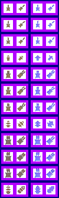

# sprite/world/entity/Tribute

`Tribute.png` holds the caravans and ships that carry shipments across the world map: taxes sent from a faction's regions to its capital, goods traded between factions, spoils and supplies sent back from armies, and goods agreed in diplomatic deals. Every kind of shipment uses the same sprites. Only the size of the load changes how it looks.

## At a glance

| | |
|---|---|
| **Location** | `assets/sprite/world/entity/` |
| **File** | `Tribute.png` |
| **Adding new files** | No. The game only asks for this name. |
| **Size** | Exactly 100 pixels wide and at least 330 high. The game's own check only asks for 224, but it reads as far as 330. A different width, or an image shorter than that, stops the game with an error. |

## The sheet

The left half, 50 pixels wide, holds the sprites in colour, and the right half holds a matching normal map. It has 12 rows of 2 cells, each cell 16 pixels square. A cell's left edge is at 6 or 28. Rows are 28 pixels apart, so a cell's top edge is at 6 plus 28 for each row, leaving 12 pixels between rows.

In each row, the left cell faces north and the right cell north-east. The game turns each one a quarter, a half and three quarters clockwise for the other directions.

Move over a sprite on the sheet to see what it's for. This is the vanilla `Tribute.png`:

## Which sprite is drawn

The rows come in three groups of four, one group for each size of load:

| Rows | Load |
|---|---|
| 0 to 3 | Fewer than 256 goods in all |
| 4 to 7 | 256 to 511 goods |
| 8 to 11 | 512 goods or more |

Within a group, the first three rows are the frames of the caravan on land, which it steps through all the time, and the fourth is the ship used on large water.

Each sprite casts a shadow in its own shape. At night, some shipments show a light. The light is drawn by the game, not taken from the sheet.

## Related

- [sprite/world/entity](00-entity.md)
- [sprite/world/entity/Army](01-army.md)
