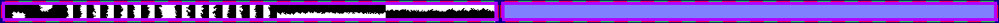

# sprite/world/map/Edge

`Edge.png` is the strip drawn over the outermost tiles of the world, which finishes the map where it meets the black beyond it.

## At a glance

| | |
|---|---|
| **Location** | `assets/sprite/world/map/` |
| **File** | `Edge.png` |
| **Adding new files** | No. The game only asks for this name. |
| **Size** | Exactly 1176 pixels wide and at least 28 high. Anything else stops the game with an error. |

## The sheet

The left half, 588 pixels wide, holds the sprites in colour, and the right half holds a matching normal map. It holds one row of 36 cells, each cell 16 pixels square. The row has a 6-pixel margin at the top and left, and the cells touch, so a cell's left edge is at 6 plus 16 for each column.

Move over a sprite on the sheet to see what it's for. This is the vanilla `Edge.png`:

## Which sprite is drawn

| Cells | Used for |
|---|---|
| 0 | The top-left corner of the world |
| 1 | The top-right corner |
| 2 | The bottom-left corner |
| 3 | The bottom-right corner |
| 4 to 11 | The left edge |
| 12 to 19 | The right edge |
| 20 to 27 | The top edge |
| 28 to 35 | The bottom edge |

Each tile along an edge picks one of that edge's 8 cells at random. The strip isn't tinted and casts no shadow.

## Related

- [sprite/world/map](00-map.md)
