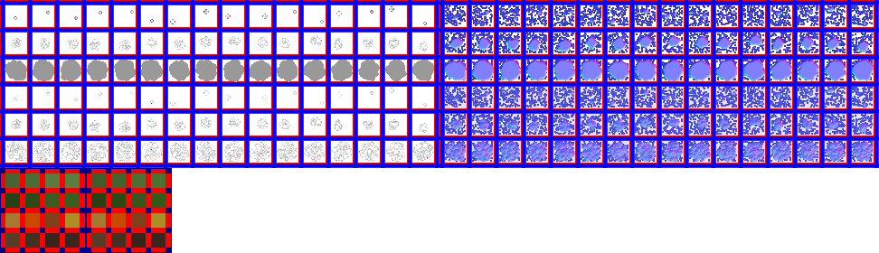

# sprite/world/map/Forest

`Forest.png` holds the trees of the world map, in three densities, and a block of swatches that sets their colour through the year.

## At a glance

| | |
|---|---|
| **Location** | `assets/sprite/world/map/` |
| **File** | `Forest.png` |
| **Adding new files** | No. The game only asks for this name. |
| **Size** | Exactly 972 pixels wide and at least 280 high. Anything else stops the game with an error. |

## The sheet

The left half, 486 pixels wide, holds the sprites in colour, and the right half holds a matching normal map. The sprites are in 6 rows of 16 cells, each cell 24 pixels square, with 6 pixels around and between them, so a cell's left edge is at 6 plus 30 for each column and its top edge is at 6 plus 30 for each row.

Below them, starting at pixel row 192, is a block of 4 rows of 4 colour swatches, each 16 pixels square, 22 pixels apart. The game reads only the top-left pixel of each swatch. A second block that looks like swatches, to the right of these, is never read.

Move over a sprite on the sheet to see what it's for. This is the vanilla `Forest.png`:

## Which sprite is drawn

Each forest tile has an amount from 1 to 3, which picks the row. Rows 0 to 2 are one set of trees and rows 3 to 5 are another, and each tile draws one cell from each set, at the same column in the same density.

| Rows | Density | Shadow |
|---|---|---|
| 0 and 3 | Amount 1, the lightest | Row 0 casts a soft shadow, row 3 none |
| 1 and 4 | Amount 2 | Row 1 casts a soft shadow, row 4 none |
| 2 and 5 | Amount 3, the densest | Row 2 casts a soft shadow, row 5 none |

The column is picked at random for each tile. The two sets are drawn in separate passes.

No trees are drawn on the tiles of a region's centre. On a tile with a full road, the forest is thinned by a random amount and shifted half a tile diagonally.

## The colours

The trees are tinted from the swatches. A swatch's colour is halved before use, so painting a swatch white leaves the sprites as painted.

The row of swatches depends on the point in the year, and the game blends smoothly from one row to the next. Over a year the rows run 3, 0, 1, 2, then back to 3. A climate whose [`SEASONAL_CHANGE`](../../../01-init/03-config/02-CLIMATE.md#seasonal_change) is 0 stays on row 1. In vanilla, rows 0 to 3 are painted green, dark green, orange and brown.

Each tree blends between the 4 columns of its row, at a random point, so a forest isn't all one shade.

The icon on the game's forest-painting tools is cell 32, the first cell of row 2, tinted with the first colour of the swatches.

## Related

- [sprite/world/map](00-map.md)
- [init/config/CLIMATE.txt](../../../01-init/03-config/02-CLIMATE.md)
