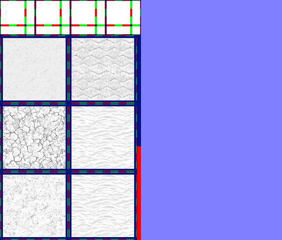

# sprite/world/map/Ground

`Ground.png` is the land of the world map. It holds the shapes where one kind of ground meets another, and four textures that the game blends into nine kinds of ground, from wet to dry, and into devastated land.

## At a glance

| | |
|---|---|
| **Location** | `assets/sprite/world/map/` |
| **File** | `Ground.png` |
| **Adding new files** | No. The game only asks for this name. |
| **Size** | Exactly 576 pixels wide and at least 346 high. The game's own check only asks for 300, but it reads as far as 346. A different width, or an image shorter than that, stops the game with an error. |

## The sheet

The left half, 288 pixels wide, holds the sprites in colour, and the right half holds a matching normal map.

| Part | Code name | Starts at pixel row | Size |
|---|---|---|---|
| Shapes | `stencil` | 0 | 4 blocks of 16 pieces, 72 pixels square, side by side |
| Textures | see below | 72 | 2 rows of 2 blocks, each 140 pixels square, 8 cells by 8 |

The cells of a texture block are 16 pixels square and touch, with a 6-pixel margin round the block. The vanilla image has a third row of texture blocks, from pixel row 352 down, which the game never reads.

Move over a sprite on the sheet to see what it's for. This is the vanilla `Ground.png`:

## The four textures

| Block | Position | Code name | Use |
|---|---|---|---|
| Top left | 0, 72 | none | The neutral ground that the others are blended over |
| Top right | 140, 72 | `sheets[0]` | Wet ground |
| Bottom left | 0, 212 | `cracked[1]` | Devastated ground |
| Bottom right | 140, 212 | `sheets[7]` | Dry ground |

The cell a tile uses comes from its position on the map, so the pattern repeats every 8 tiles. A transparent pixel in the wet or dry texture lets the neutral ground show through.

## The nine kinds of ground

The game builds eight blends and shares them between nine kinds of ground, numbered here from 0, the wettest, to 8, the driest.

| Kind | Texture |
|---|---|
| 0 and 1 | Wet, at full strength |
| 2 | 71% wet over neutral |
| 3 | 43% wet over neutral |
| 4 | 14% wet over neutral |
| 5 | 14% dry over neutral |
| 6 | 43% dry over neutral |
| 7 | 71% dry over neutral |
| 8 | Dry, at full strength |

The colour of each kind comes from the `COLOR` list in [`init/world/config/Ground.txt`](../../../01-init/15-world/02-config/03-Ground.md#color), multiplied by a tint that changes with the seasons.

## Where kinds meet

A tile connects on each side where the neighbouring tile has its kind or uses its kind as a background, and at the edge of the world. A tile connected on all four sides is drawn whole.

On any other tile, the game first draws, whole, the kind one step closer to kind 4, the middle of the range. Then it draws the tile's own kind through its `stencil` shape. There are 4 blocks of shapes, picked at random for each tile. Kind 4 itself has no kind to sit on, so it's always drawn whole. The piece for all four sides is loaded but never drawn.

## Devastated land

Tiles in a region with devastation above 0.25 use no shape, and draw a devastated texture instead:

| Devastation | Texture |
|---|---|
| Above 0.25 and below 0.75 | Half neutral, half devastated |
| 0.75 and above | Devastated alone |

The tint moves from the kind's colour towards a devastated colour as devastation rises. That colour runs from `COLOR_DEVASTATED_WET` on the wettest kind to `COLOR_DEVASTATED_DRY` on the driest.

## Related

- [sprite/world/map](00-map.md)
- [init/world/config/Ground.txt](../../../01-init/15-world/02-config/03-Ground.md)
