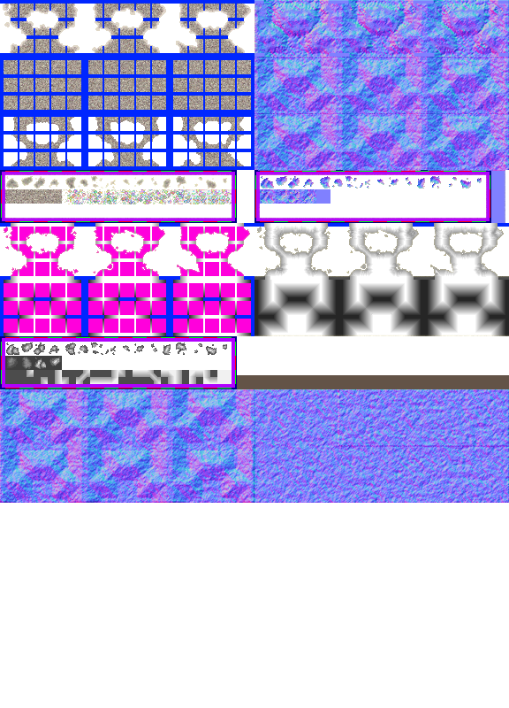

# sprite/world/map/Mountain

`Mountain.png` holds the mountains of the world map, at every height. A mountain tile is built from a body and a top in different shades of grey, so a range looks layered.

## At a glance

| | |
|---|---|
| **Location** | `assets/sprite/world/map/` |
| **File** | `Mountain.png` |
| **Adding new files** | No. The game only asks for this name. |
| **Size** | Exactly 576 pixels wide and at least 316 high. Anything else stops the game with an error. |

## The sheet

The left half, 288 pixels wide, holds the sprites in colour, and the right half holds a matching normal map.

The top holds 9 blocks, 3 across and 3 down, each 96 pixels wide and 64 high. Their cells are 16 pixels square, and aren't in a simple grid, so use the tooltips to find them. Below them, a block starts at pixel row 192 with a 6-pixel margin. Its first row holds 16 cells and its second row 4, all 16 pixels square and touching. Everything else below is never read, though the vanilla image is 800 pixels high.

Each block has one piece for every combination of its four corners. The piece for no corners shares a cell with the piece for the north-east and south-east corners, and is never drawn, so painting that cell paints the other piece.

Move over a sprite on the sheet to see what it's for. This is the vanilla `Mountain.png`:

## Which sprite is drawn

A tile's piece depends on its corners. A corner joins when the tile on that diagonal and the two tiles beside it are all mountain at least as high as this one, and there's no water at that corner. Tiles beyond the edge of the world count as high enough. Each sprite is drawn half a tile right and down from its tile, so it straddles four tiles.

| Blocks | Code | Used for |
|---|---|---|
| 0 to 2 (top row) | `EDGES` | A tile at the lowest height with at least one corner joined. Block 0 and 1 give three versions each and block 2 gives two, counting turned copies, and one of the 8 is picked at random. |
| 3 to 5 (middle row) | `FULLS` | The body of a tile above the lowest height with at least one corner joined. They give 8 versions in the same way. |
| 6 to 8 (bottom row) | `TOPS` | The top, drawn over the body. Blocks 6 and 7 give one version each, and block 8 gives two. One of the 4 is picked at random. |
| Row of 16 cells | `SINGLES` | A lone rock at the lowest height with no corners joined. One of 32, these cells and their turned copies. |
| Row of 4 cells | `SINGLES_FULLS` | A lone rock above the lowest height with no corners joined. One of 16, these cells in their four turns. |

## The colours

A mountain's colour is set in code, not by any file: 15 shades of grey, from 80 at the lowest height to 210 at the highest. A sprite is drawn in colour for the shade of its height:

- A tile at the lowest height uses the first shade.
- A body, and a lone rock above the lowest height, use the shade just below the tile's height.
- A top uses the shade of the tile's height.

Mountains cast no shadow.

## The icon

The icon on the game's mountain-painting tools is made from four pieces of block 0, each for a single corner. The south-east piece fills its upper-left quarter, the south-west piece the upper right, the north-east piece the lower left, and the north-west piece the lower right.

## Related

- [sprite/world/map](00-map.md)
