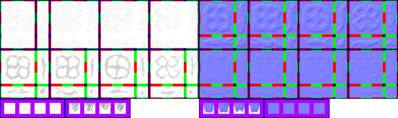

# sprite/world/map/RiverBig

`RiverBig.png` holds the big rivers of the world map and the mouths where they run into a lake or the ocean.

## At a glance

| | |
|---|---|
| **Location** | `assets/sprite/world/map/` |
| **File** | `RiverBig.png` |
| **Adding new files** | No. The game only asks for this name. |
| **Size** | Exactly 576 pixels wide and at least 172 high. Anything else stops the game with an error. |

## The sheet

The left half, 288 pixels wide, holds the sprites in colour, and the right half holds a matching normal map.

| Part | Code name | Starts at pixel row | Size |
|---|---|---|---|
| Banks | `riverBG` | 0 | 4 blocks of 16 pieces |
| Water | `riverFG` | 72 | 4 blocks of 16 pieces |
| River mouth, shore | `deltaShore` | 150 | 4 cells, starting at pixel 6, 22 pixels apart |
| River mouth, water | `delta` | 150 | 4 cells, starting at pixel 100, 22 pixels apart |

Move over a sprite on the sheet to see what it's for. This is the vanilla `RiverBig.png`:

## Which sprite is drawn

Each river tile uses the piece for the sides that join more river, from one of 8 versions picked at random: the four painted blocks and their turned copies. All 16 pieces are drawn. The banks are tinted with `COLOR_LAKE_SHORE` and the water with `COLOR_LAKE`, on rivers that reach the ocean too. Two scrolling textures from `sprite/textures` are drawn faintly over the water.

## River mouths

Where a river meets open water, the last tile draws a straight piece of river running from that side to the opposite one, then a `delta` and `deltaShore` cell over it. The cell is one of 4 picked at random, and the game turns it to face the first side with open water, trying north, east, south and west in that order. As painted, the open water is to the north. These cells are tinted with the colours of the lake or ocean they meet.

## Related

- [sprite/world/map](00-map.md)
- [sprite/world/map/RiverSmall](08-riversmall.md)
- [init/world/config/Water.txt](../../../01-init/15-world/02-config/05-Water.md)
