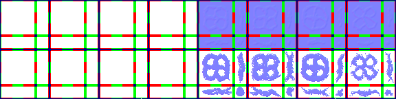

# sprite/world/map/RiverSmall

`RiverSmall.png` holds the small rivers of the world map.

## At a glance

| | |
|---|---|
| **Location** | `assets/sprite/world/map/` |
| **File** | `RiverSmall.png` |
| **Adding new files** | No. The game only asks for this name. |
| **Size** | Exactly 576 pixels wide and at least 144 high. Anything else stops the game with an error. |

## The sheet

The left half, 288 pixels wide, holds the sprites in colour, and the right half holds a matching normal map.

| Part | Code name | Starts at pixel row | Size |
|---|---|---|---|
| Banks | `riverSmallBG` | 0 | 4 blocks of 16 pieces |
| Water | `riverSmallFG` | 72 | 4 blocks of 16 pieces |

Move over a sprite on the sheet to see what it's for. This is the vanilla `RiverSmall.png`:

## Which sprite is drawn

Each river tile uses the piece for the sides that join more river, from one of 8 versions picked at random: the four painted blocks and their turned copies. All 16 pieces are drawn. The banks are tinted with `COLOR_LAKE_SHORE` and the water with `COLOR_LAKE`. Unlike big rivers, small rivers have no scrolling texture over them.

Where a small river meets other water, it also draws the piece for the opposite side on that neighbouring tile, from the same random version, so the river runs into the water.

## Related

- [sprite/world/map](00-map.md)
- [sprite/world/map/RiverBig](07-riverbig.md)
- [init/world/config/Water.txt](../../../01-init/15-world/02-config/05-Water.md)
