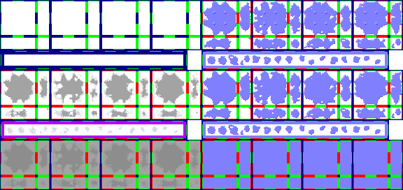

# sprite/world/map/Water

`Water.png` holds the lakes and oceans of the world map: their shores, their water, and the deep water far from land.

## At a glance

| | |
|---|---|
| **Location** | `assets/sprite/world/map/` |
| **File** | `Water.png` |
| **Adding new files** | No. The game only asks for this name. |
| **Size** | Exactly 576 pixels wide and at least 272 high. Anything else stops the game with an error. |

## The sheet

The left half, 288 pixels wide, holds the sprites in colour, and the right half holds a matching normal map.

| Part | Code name | Starts at pixel row | Size |
|---|---|---|---|
| Shores | `bg` | 0 | 4 blocks of 16 pieces |
| Single-tile shores | `bgSingles` | 72 | A row of 16 cells |
| Water | `sheet` | 100 | 4 blocks of 16 pieces |
| Single-tile water | `sheetSingles` | 172 | A row of 16 cells |
| Deep water | `deep` | 200 | 4 blocks of 16 pieces, of which only the first two are drawn |

A row of 16 cells has a 6-pixel margin at the top and left, and the cells touch.

Move over a sprite on the sheet to see what it's for. This is the vanilla `Water.png`:

## Which sprite is drawn

A water tile connects to the water north, east, south and west of it.

- **No connections:** `sheetSingles` and `bgSingles`, one of 16 cells picked at random from each.
- **Any other combination:** a piece from `sheet`, from one of 8 versions picked at random: the four painted blocks and their turned copies.
- **Shores:** a tile with some but not all sides connected also draws the same piece from `bg`. So `bg`'s pieces for no connections and all four are never drawn, and neither are `sheet`'s pieces for no connections, except the one below.

### Corners

A corner notch is added when a tile's diagonal neighbour isn't water though the two tiles beside that corner are. The notch comes from the piece for no connections in the first `sheet` block. It's painted as the north-east corner, and the game turns it for the other three and combines them as needed.

### Deep water

Deep water sits on its own tiles, which the world generator places in the deeper parts of lakes and oceans. A deep tile connects only to other deep water and to the edge of the world, and its piece comes from one of 4 versions: the first two `deep` blocks and their turned copies. The third and fourth blocks are loaded but never drawn.

## The colours

| Part | Tint |
|---|---|
| `bg`, `bgSingles` | `COLOR_LAKE_SHORE` or `COLOR_OCEAN_SHORE` |
| `sheet`, `sheetSingles`, `deep` | `COLOR_LAKE` or `COLOR_OCEAN`, multiplied by a tint that changes with the seasons |

All four come from [`init/world/config/Water.txt`](../../../01-init/15-world/02-config/05-Water.md). Two scrolling textures from `sprite/textures` are drawn faintly over the water and deep water.

## Related

- [sprite/world/map](00-map.md)
- [sprite/world/map/RiverBig](07-riverbig.md)
- [init/world/config/Water.txt](../../../01-init/15-world/02-config/05-Water.md)
