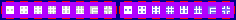

# sprite/world/map/buildings/Garrison

`Garrison.png` holds the marker that shows how large a region's garrison is, drawn at the region's centre.

## At a glance

| | |
|---|---|
| **Location** | `assets/sprite/world/map/buildings/` |
| **File** | `Garrison.png` |
| **Adding new files** | No. The game only asks for this name. |
| **Size** | Exactly 236 pixels wide and at least 20 high. Anything else stops the game with an error. |

## The sheet

The left half, 118 pixels wide, holds the sprites in colour, and the right half holds a matching normal map. It holds one row of 8 cells, each cell 8 pixels square, with 6 pixels around and between them, so a cell's left edge is at 6 plus 14 for each column.

Move over a sprite on the sheet to see what it's for. This is the vanilla `Garrison.png`:

## Which sprite is drawn

A region with no garrison draws no marker. Otherwise the cell is set by the region's garrison, as a number from 0 to 1 scaled to the 8 cells and rounded, so column 0 is the smallest and column 7 the largest. The game turns the sprite to one of four directions at random.

Each region's centre has one quarter-tile spot for the marker, picked from the region's number. The marker replaces the house that would stand on that spot. It casts no shadow.

## Related

- [sprite/world/map/buildings](00-buildings.md)
