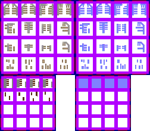

# sprite/world/map/buildings/Harbour

`Harbour.png` holds the harbours drawn where a road reaches open water.

## At a glance

| | |
|---|---|
| **Location** | `assets/sprite/world/map/buildings/` |
| **File** | `Harbour.png` |
| **Adding new files** | No. The game only asks for this name. |
| **Size** | Exactly 252 pixels wide and at least 220 high. Anything else stops the game with an error. |

## The sheet

The left half, 126 pixels wide, holds the sprites in colour, and the right half holds a matching normal map.

| Part | Code name | Cells | Starts at pixel row |
|---|---|---|---|
| Harbours | `harbour` | 4 rows of 4, each 24 pixels square | 0 |
| River harbours | `harbourRiver` | 4 rows of 4, each 16 pixels square | 126 |

Each part has 6 pixels around and between its cells. `harbourRiver` is loaded but never drawn.

Move over a sprite on the sheet to see what it's for. This is the vanilla `Harbour.png`:

## Which sprite is drawn

A harbour is drawn on a road tile on big water, unless it's a small track, a region's centre, or a tile where a bridge was drawn. The sprite sits 4 pixels up and left of the tile, and casts a shadow.

As painted, the road arrives from the south. The game turns the sprite so that it faces away from the first side the road connects on, trying north, east, south and west in that order.

The cells are numbered row by row, from 0 at the top left to 15 at the bottom right.

| Road tile | Cell |
|---|---|
| Exactly one connection, in a region | One of 4 cells in a row, picked at random, starting at cell 0 for a road level above two thirds, 1 down to one third, 2 down to just above 0, and 3 at level 0. So cells 0 to 6 can appear. |
| Exactly one connection, in no region | Cells 11 to 14 |
| Any other number of connections | Cells 12 to 15 |

Cells 7 to 10 are never drawn.

The road level is the same one that tints the [roads](04-roads.md).

## Related

- [sprite/world/map/buildings](00-buildings.md)
- [sprite/world/map/buildings/Roads](04-roads.md)
