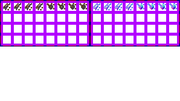

# sprite/world/map/buildings/Mines

`Mines.png` holds the small animated mines scattered over a region that has mining buildings.

## At a glance

| | |
|---|---|
| **Location** | `assets/sprite/world/map/buildings/` |
| **File** | `Mines.png` |
| **Adding new files** | No. The game only asks for this name. |
| **Size** | Exactly 364 pixels wide and at least 100 high. Anything else stops the game with an error. |

## The sheet

The left half, 182 pixels wide, holds the sprites in colour, and the right half holds a matching normal map. Only the first row is read: 8 cells, each 16 pixels square, with 6 pixels around and between them, so a cell's left edge is at 6 plus 22 for each column. The vanilla image is 204 pixels high, but everything below that row is unused.

Move over a sprite on the sheet to see what it's for. This is the vanilla `Mines.png`:

## Which sprite is drawn

The row holds two styles of mine, 4 frames each. Cells 0 to 3 are the first style and cells 4 to 7 the second. Each mine tile picks a style at random, then plays its frames 0, 1, 2, 3, 3, 2, 1, 0, moving two steps every second at normal game speed. The animation follows the game's speed and stops while the game is paused.

A mine appears on a land tile in a region. How many appear depends on the region's mine level, the boost `WORLD_VISUAL_MINE` held between 0 and 1: at the highest level, about 7 tiles in every 256. In vanilla, the mining buildings in `init/world/building/mine/_GEN.txt` add 1 to it, scaled by how well they [run](../../../../01-init/15-world/01-building.md#boost).

Mines aren't tinted and cast no shadow.

## Related

- [sprite/world/map/buildings](00-buildings.md)
- [init/world/building](../../../../01-init/15-world/01-building.md)
