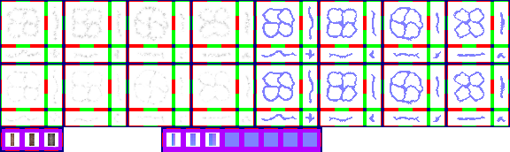

# sprite/world/map/buildings/Roads

`Roads.png` holds the roads of the world map, the small tracks that branch off them, and the bridges that carry roads over water.

## At a glance

| | |
|---|---|
| **Location** | `assets/sprite/world/map/buildings/` |
| **File** | `Roads.png` |
| **Adding new files** | No. The game only asks for this name. |
| **Size** | Exactly 576 pixels wide and at least 172 high. Anything else stops the game with an error. |

## The sheet

The left half, 288 pixels wide, holds the sprites in colour, and the right half holds a matching normal map.

| Part | Code name | Starts at pixel row | Size |
|---|---|---|---|
| Roads | `roads` | 0 | 4 blocks of 16 pieces |
| Small tracks | `roadsMini` | 72 | 4 blocks of 16 pieces |
| Bridges | `bridge` | 150 | 3 cells, each 16 pixels square, starting at pixel 6, 22 pixels apart |

Move over a sprite on the sheet to see what it's for. This is the vanilla `Roads.png`:

## Which sprite is drawn

A road tile uses the piece for the sides that join another road of its own kind, from one of 8 versions picked at random: the four painted blocks and their turned copies. Small tracks are made by the world generator as side roads, and by a road-painting tool that makes a road smaller.

Where a road meets one of the other kind, a small track piece towards those neighbours is drawn first, in the lowest colour.

## The colours

Roads are tinted along a scale of 16 steps from [`COLOR_SMALL`](../../../../01-init/15-world/02-config/04-Road.md#color_small) to [`COLOR_BIG`](../../../../01-init/15-world/02-config/04-Road.md#color_big). The step comes from the region's road level, the boost `WORLD_VISUAL_ROADS` held between 0 and 1 and stored in fifteenths, rounded down:

- A full road sits at 0.75 plus a quarter of the level, near the `COLOR_BIG` end.
- A small track sits at a quarter of the level, near the `COLOR_SMALL` end.

In vanilla, the levels of `init/world/building/infra/ROAD.txt` add 0.1, 0.2, 0.4, 0.8 and 1.0.

## Bridges

A full road over big water draws a bridge when the tile is flagged as one, has no big water on two opposite sides, and the path runs only that way. As painted, a bridge runs north to south, and the game turns it for east to west. Bridges aren't tinted and cast no shadow.

The game picks the sprite with the road level multiplied by 4, then adds the direction. That sum runs along the turned copies rather than across the cells, so higher levels don't simply pick the next cell:

| Road level | Sprite |
|---|---|
| Below 0.25 | Cell 0, in the right direction |
| 0.25 to below 1 | Shifted along the turned copies, so it may be cell 0 in the wrong direction, or cell 1 |
| 1 | Cell 1, in the right direction |

Cell 2 is loaded but never drawn.

## Related

- [sprite/world/map/buildings](00-buildings.md)
- [sprite/world/map/buildings/Harbour](02-harbour.md)
- [init/world/config/Road.txt](../../../../01-init/15-world/02-config/04-Road.md)
