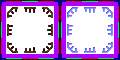

# sprite/world/map/buildings/Siege

`Siege.png` holds the camp drawn round the centre of a besieged region.

## At a glance

| | |
|---|---|
| **Location** | `assets/sprite/world/map/buildings/` |
| **File** | `Siege.png` |
| **Adding new files** | No. The game only asks for this name. |
| **Size** | Exactly 120 pixels wide and at least 60 high. Anything else stops the game with an error. |

## The sheet

The left half, 60 pixels wide, holds the sprites in colour, and the right half holds a matching normal map. It holds one block of 3 rows of 3 cells, each cell 16 pixels square. The block has a 6-pixel margin, and the cells inside it touch, so a cell's left edge is at 6 plus 16 for each column and its top edge is at 6 plus 16 for each row.

Move over a sprite on the sheet to see what it's for. This is the vanilla `Siege.png`:

## Which sprite is drawn

The 9 cells are a 3 by 3 grid drawn around the centre of any besieged region, both capitals and others. On the map they're drawn a tile and a half apart, with gaps between them, so a cell keeps its place in the grid but doesn't touch its neighbours. The middle cell is blank in vanilla.

The sprites aren't tinted, and they cast a hard shadow.

## Related

- [sprite/world/map/buildings](00-buildings.md)
