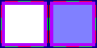

# sprite/world/map/buildings/TerrainStencil

`TerrainStencil.png` holds the shapes that cut out the ground at a region's centre. Every race's [terrain sheet](../../01-centre/03-terrain.md) is drawn through them.

## At a glance

| | |
|---|---|
| **Location** | `assets/sprite/world/map/buildings/` |
| **File** | `TerrainStencil.png` |
| **Adding new files** | No. The game only asks for this name. |
| **Size** | Exactly 120 pixels wide and at least 60 high. Anything else stops the game with an error. |

## The sheet

The left half, 60 pixels wide, holds the sprites in colour, and the right half holds a matching normal map. It holds one block of 3 rows of 3 cells, each cell 16 pixels square. The block has a 6-pixel margin, and the cells inside it touch, so a cell's left edge is at 6 plus 16 for each column and its top edge is at 6 plus 16 for each row.

Move over a sprite on the sheet to see what it's for. This is the vanilla `TerrainStencil.png`:

## Which sprite is drawn

The cells follow the layout of a region's centre, with a corner in each corner of the block, a side on each side, and the middle in the middle. A 3-tile centre uses each cell once. In a capital's 4-tile centre, the two middle tiles of each side share that side's shape, and the four middle tiles share the middle one.

## Related

- [sprite/world/map/buildings](00-buildings.md)
- [sprite/world/centre/terrain](../../01-centre/03-terrain.md)
